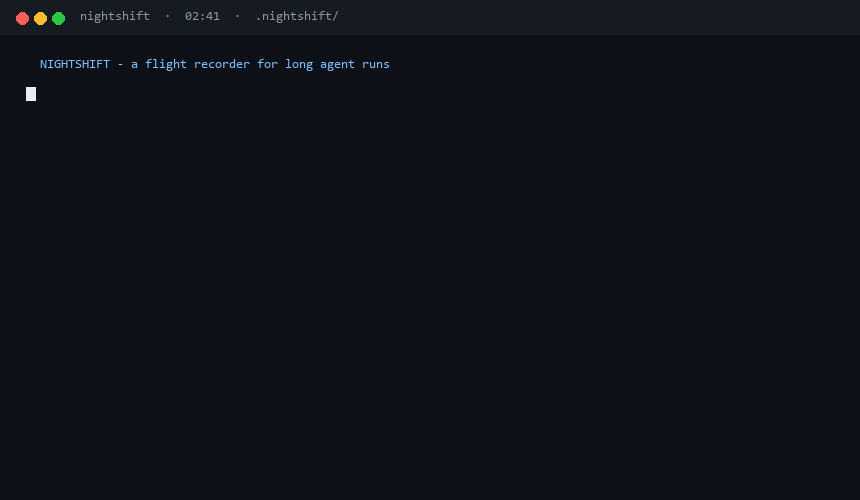
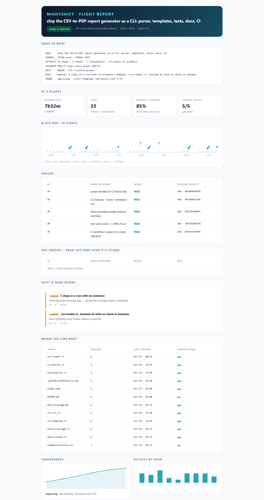
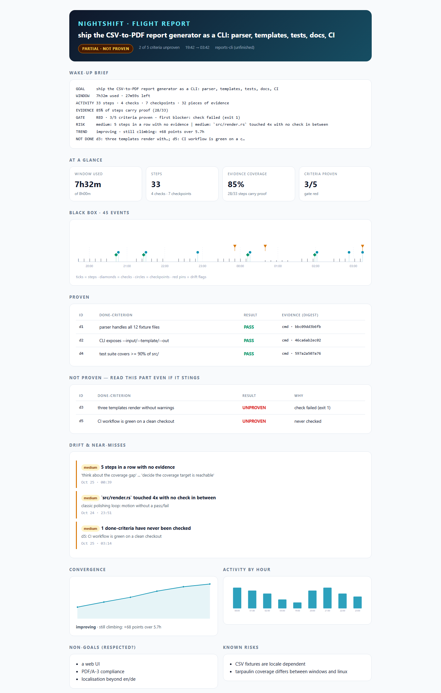

# NIGHTSHIFT

**Give your coding agent a night shift. Wake up to a flight report, not a fantasy.**

A skill + a zero-dependency CLI that turns a long unattended agent run into
something a human can audit in five minutes.

<p align="center">
  
</p>

<p>


</p>

```
$ nsh brief
GOAL      ship the CSV-to-PDF report generator as a CLI: parser, templates, tests, docs, CI
WINDOW    7h32m used · 27m left
ACTIVITY  33 steps · 5 checks · 7 checkpoints · 33 pieces of evidence
EVIDENCE  85% of steps carry proof (28/33)
GATE      GREEN · 5/5 criteria proven
RISK      medium: 5 steps in a row with no evidence | medium: src/render.rs touched 4x with no check
TREND     improving - still climbing: +68 points over 5.7h
```

---

> **A skill is a request. An exit code is a fact.**

---

## The problem

You go to sleep. The agent works. You wake up to:

> "Done! I refactored the parser, added tests, and updated the docs. Note: the
> tests might need a small tweak, and I couldn't verify the CI config."

Three things just happened, and none of them are in the sentence:

1. **"Done" was never defined**, so it cannot be wrong.
2. **"Added tests" has no receipt** — no command, no exit code, no output.
3. **The run drifted**: somewhere around hour three it spent 90 minutes on a
   landing page you never asked for.

Agent frameworks solve orchestration. Eval platforms solve offline scoring.
Nobody solves the thing you actually need at 07:00: **a truthful summary of a
night you did not watch.**

## What NIGHTSHIFT does

| Mechanism | What it kills |
| --- | --- |
| **Flight plan** — goal, 3-6 *checkable* done-criteria, non-goals, deadline | "Done" as a feeling |
| **Black box** — append-only `events.jsonl`, evidence captured at action time | Claims without receipts |
| **Checkpoints** — honest progress + drift detection every ~45 min | Silent drift, endless polishing |
| **Convergence check** — three flat checkpoints = stop | Hour 7 costing more than it buys |
| **Evidence gate** — `nsh gate` exits 0 only if every criterion passed *with* proof | Green-by-vibes |
| **Verification** — `nsh verify` recomputes every hash; a tampered receipt fails | Evidence nobody ever checked |
| **Flight report** — a single self-contained HTML file with a mandatory *"Not proven"* section | Morning surprises |

## Quickstart (60 seconds, no API key, no service)

```bash
git clone https://github.com/chchliu/nightshift && cd nightshift
python -m nightshift demo --open
```

That builds a scripted 7.5-hour run — real black box, real evidence files, real
digests — and opens the flight report. Read the **Not proven** section first.
It is the point.

Then drive your own run (`nsh` below is the installed entry point; without an
install, every one of these is `python -m nightshift`):

```bash
pipx install .                    # optional, gives you `nsh` on PATH

nsh init --goal "ship v0.1 of the report CLI" --deadline "06:40"
nsh done add "tests pass"        -- python -m pytest -q
nsh done add "the CLI builds"    -- npm run build
nsh done add "quickstart exists" -- python scripts/check_readme.py

nsh run  -- python -m pytest -q          # runs it, captures stdout+exit as proof
nsh step "rewrote the intro by hand" -e README.md
nsh tick --progress 40 --note "parser done, templating next"

nsh gate        # exit 0 only when every criterion is proven
nsh verify      # recompute every evidence digest against the bytes on disk
nsh report      # .nightshift/reports/flight-report.html
nsh brief       # the ten lines above
```

New here and want to see one whole shift before installing anything? Read
[`docs/WALKTHROUGH.md`](docs/WALKTHROUGH.md) — one night, real command output,
five minutes.

## Install the skill (so the agent does this by itself)

The CLI is half of it. The other half is `SKILL.md`, which tells the agent the
seven laws and when to call `nsh`.

```bash
# Claude Code / Claude Agent SDK
cp -r . ~/.claude/skills/nightshift

# DeepSeek Harness
cp -r . ~/.dsh/skills/nightshift

# Codex / Cursor / anything that reads AGENTS.md or a rules file
cat SKILL.md >> AGENTS.md
```

Then just say:

> *"Work on this until it's done. I'm going to sleep, deadline 06:30."*

The agent writes the flight plan, records receipts, checkpoints itself, and
leaves a report.

## What the report looks like

<p align="center">
  
</p>

One file, no CDN, no JavaScript, printable:

- **Verdict first** — `DONE & PROVEN` / `PARTIAL · NOT PROVEN` / `BUDGET SPENT · GATE RED`, with the number behind it.
- **Wake-up brief** — ten lines, written for a stranger.
- **Black-box timeline** — every step, check and checkpoint, drift flags pinned to the moment they happened.
- **Proven / Not proven** — side by side, each with a sha256 of the captured bytes.
- **Drift & near-misses** — the churn loop, the silent stretch, the thing that almost went wrong at 04:10.
- **Convergence + activity** — was hour seven worth it?

There is also a 33-second vertical cut for people who would rather watch than
read: [`docs/nightshift-vertical.mp4`](docs/nightshift-vertical.mp4) (Chinese
captions, 1080×1920, no audio — add your own track).

### What a bad night looks like

<p align="center">
  
</p>

`nsh demo --red` builds the same shift with two criteria unproven: one check
failed and one was never run. The report says `PARTIAL · NOT PROVEN`, puts both
in the **Not proven** table with the reason, and the brief ends with a
`NOT DONE` line.

This is the report that matters. A tool that can only show you green is a
cheerleader; the morning you need is the one that tells you which two things did
not happen.

## The seven laws

1. The plan comes before the work.
2. Every claim leaves a receipt, captured at action time.
3. Checkpoints are cheap, drift is expensive.
4. A red gate is not a failure of the run — it is the run's product.
5. Stop when the meter says stop.
6. Never rewrite the log.
7. The brief is written for a stranger.

Full text: [`SKILL.md`](SKILL.md) · protocol spec: [`docs/PROTOCOL.md`](docs/PROTOCOL.md)

## Who this is for

Anyone who leaves an agent working and then has to trust the result:

- **Developers shipping a feature overnight.** The morning report says which
  tests never ran, and which file was edited four times without a check.
- **Researchers running long jobs.** "The pipeline finished" stops being a
  sentence and becomes a row with an exit code and a hash. If your simulation
  writes a result file, that file is the evidence.
- **Analysts rebuilding a dataset.** Row counts, duplicate ids, date ranges and
  schema checks become done-criteria; the report shows which ones ran at 04:10
  and what they printed.
- **Writers, designers and ops people** producing deliverables that must parse:
  a PDF that renders, a spec with all nine sections, a config that validates, a
  deck that opens.
- **Students and hobbyists** who want to know what the agent actually did at 3am
  instead of what it says it did.

The only requirement is that "done" can be expressed as a command. If it can
only be expressed as a feeling, no tool helps — including this one.

## This repo was built by its own skill

<!--DOGFOOD:START-->
`.nightshift/` in this repository is the real, append-only log of the shift that
built v0.1 — no edited highlights. Every number below is read out of it.

| | |
| --- | --- |
| done-criteria | 5, all proven with captured output |
| log | 35 events — 11 steps, 20 checks, 3 checkpoints |
| evidence | 36 artefacts, hashed |
| evidence coverage | 100 % of steps carry a receipt (every re-check is appended, so the counts grow) |
| verdict | **DONE & PROVEN** |

Three things the shift caught that a chat summary would have glossed over:

- **The topical detector flagged this very run** (`plan overlap 0.097`). Measured
  across the corpus it could not separate legitimate new vocabulary from working
  on something else, so it was demoted to an advisory, and the measurement ships
  in [`docs/BENCHMARKS.md`](docs/BENCHMARKS.md).
- **A reviewer pass found `Path.write_text(newline=...)`** — a 3.10-only API — in
  the report writer, which would have raised on every single run at the floor we
  advertised. The floor is now 3.10, and the claim matches the code.
- **`nsh verify` failed in a fresh clone.** `* text=auto eol=lf` was rewriting
  the CRLF inside captured output at commit time, changing the bytes and
  breaking the digests. Evidence is now stored as opaque blobs.

That last one is the argument in miniature: the tool caught its own receipt
being altered by the version control system — precisely the class of thing a
"done!" message never tells you.
<!--DOGFOOD:END-->

## Benchmarks, honestly

`nsh bench` runs the detectors over a labelled corpus of synthetic runs:

```
structural drift  precision 1.00   recall 0.80   f1 0.89   (silent_run + churn)
topical advisory  precision 0.75   recall 1.00   f1 0.86   (off_topic, low severity)
gate              accuracy 1.00
confusion         tp=4 fp=0 tn=11 fn=1
```

The corpus is 15 synthetic runs plus **one real one**: this repository's own
shift, exported verbatim, including the topical flag that was wrong.

Three caveats, all printed by the tool itself:

- **The corpus is synthetic and labelled by construction.** These numbers are a
  regression test for the heuristics, not a scientific benchmark of real agents.
- **There is one known false negative**: churn on a file you never passed to
  `--target` is invisible. The detector can only see what it was told.
- **One detector was demoted, not tuned.** The topical check first shipped as a
  medium-severity flag, then fired on the very run that was building this repo.
  We measured it, could not separate "legitimate new vocabulary" from "working
  on something else", and made it advisory instead of guessing a threshold.
  The numbers are in [`docs/BENCHMARKS.md`](docs/BENCHMARKS.md).

## What this is not

- **Not an agent framework.** It does not run your agent. It watches it.
- **Not an eval platform.** It does not score models. It scores one shift.
- **Not a sandbox.** It records what happened; it does not stop you.
- **Not magic.** The drift detector is four heuristics and a tokenizer. It is
  wrong sometimes, and it says so in the report.

## Design notes

- **Zero dependencies.** Python 3.10+, standard library only. It has to run in
  whatever container your agent woke up in.
- **Append-only.** The log can be added to, never edited. Corrections are new
  events, not rewrites.
- **Evidence is bytes, not links.** sha256 of captured output; re-render the
  report anytime, the digests do not move.
- **Heuristics are visible.** Every drift finding shows its score, its window and
  the events behind it. A detector you cannot inspect is just another thing to
  trust blindly.

## FAQ

**Does it need an API key?** No. Nothing here calls a model.
**Does it work with Codex / Cursor / Claude Code / DSH?** Yes — it is a `SKILL.md`
plus a CLI. The harness only has to be able to run a shell command.
**Will my agent actually follow it?** That is what the gate is for. A skill is a
request; an exit code is a fact.
**Does it work for non-coding work?** Yes, as long as "done" can be a command:
a document that must exist and parse, a dataset that must pass validation, a
build that must succeed.
**Windows?** Yes. CI runs on Windows, macOS and Linux.

## Contributing

The most useful contribution is a **real run**: drop a labelled
`bench/cases/*.json` from a shift you actually ran, especially one where the
detector was wrong. See [`CONTRIBUTING.md`](CONTRIBUTING.md).

## License

MIT. Go build something at 2am.
